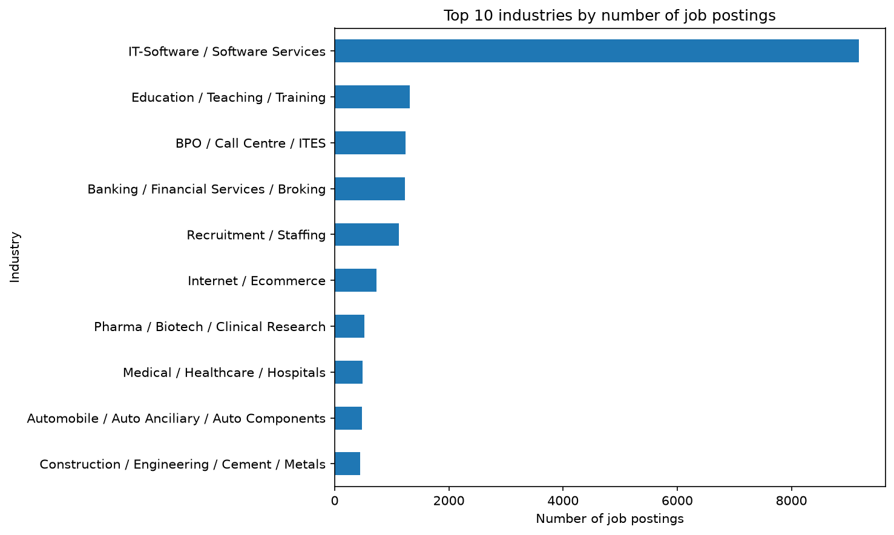
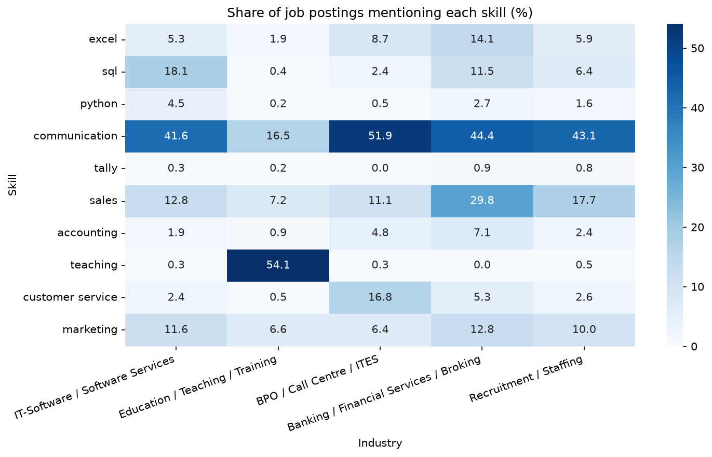

# India Jobs & Skills Analysis

Which industries post the most jobs in India, and which skills do employers mention most? This project answers both questions using about 22,000 Naukri.com job postings, with a complete Python workflow from raw data to findings.

  

## Questions

1. Which industries have the most job postings?
2. Which skills are mentioned most in job descriptions, and does that change by industry?

## Key findings

**1. IT-Software dominates the sample.** IT-Software / Software Services accounts for **9,184 of 21,909 postings (41.9%)**, about 7 times more than any other industry. Education, BPO, Banking and Recruitment follow closely together at roughly 5-6% each.



**2. Communication is the most mentioned skill, but every industry has its own signature skill.** Among the 10 skills tracked, communication leads in four of the five biggest industries (42-52% of postings). Education is the exception, where teaching leads (54%).

| Industry | Signature skill | Share of postings |
|---|---|---|
| IT-Software | SQL | 18.1% |
| Education | Teaching | 54.1% |
| BPO / Call Centre | Customer service | 16.8% |
| Banking / Financial Services | Sales | 29.8% |



## Data

- **Source:** Kaggle dataset "Job Market Analysis of India" (Naukri.com job postings)
- **Size:** 22,000 rows and 14 columns before cleaning, 21,909 rows and 12 columns after
- **Period:** January 2015 to January 2017 (most postings are from 2016)

## Cleaning steps

| # | Step | Why |
|---|---|---|
| 1 | Dropped `site_name` (81.9% missing) and `numberofpositions` (79.7% missing) | Too empty to fill reliably |
| 2 | Removed 1 exact duplicate (same content, different IDs) | Avoid double counting |
| 3 | Kept the newest posting for each of ~90 repeated `jobid`s | `postdate` was the only column that differed, so these were reposts of the same job |
| 4 | Found that the `skills` column holds department names (Marketing, Accounts), not skills | Extracted real skills from the job descriptions instead |
| 5 | Removed the website footer block (industry and functional-area labels) from every description | The labels made some skills look universal: "teaching" appeared in 100% of Education postings, and 54% after cleaning |
| 6 | Matched whole words only, with optional plurals | Stops "excel" matching "excellent" and "sql" matching "mysql" |

## Limitations

- This is a **sample from one website, 2015-2017**. It is not the whole Indian job market, and skill demand has changed since then (for example, Python appears in only 4.5% of IT postings here).
- Counts are **postings, not openings**. One posting can fill several positions, but that column was mostly empty.
- Only **10 skills** were tracked, so a skill that is not on the list cannot appear.
- Keyword matching shows that a skill is **mentioned**, not that it is required. Phrases like "good communication skills" are standard in many job ads.

## Project structure

```
india-jobs-skills-analysis/
├── data/raw/        original Naukri dataset (never edited)
├── notebook/        1_explore.ipynb (full analysis)
├── images/          charts used in this README
└── README.md
```

## How to run

1. Clone the repo and open the folder
2. Create the environment: `python -m venv venv`, then activate it
3. Install the packages: `python -m pip install -r requirements.txt`
4. Open `notebook/1_explore.ipynb` and click **Run All**

## Tools

Python, pandas, matplotlib, seaborn, Jupyter, Git and GitHub

## Author

Sadeep Dudekula - [GitHub](https://github.com/SadeepDudekula)